# Лабораторная работа 1. Сбор, визуализация и анализ данных по графу

**Тема:** Retrieval-Augmented Generation (RAG) — генерация текста языковыми моделями с подключением внешнего поиска.
Тема узкая, быстрорастущая и содержит несколько подобластей (графы знаний, мультимодальность, агенты, безопасность), поэтому на ней хорошо видна кластерная структура.

## Структура проекта

| Файл | Назначение | Пункты |
|---|---|---|
| `01_collect.py` | выгрузка из arXiv API | 1–2 |
| `02_eda.py` | разведочный анализ, закон Ципфа и Хипса | 3 |
| `common.py`, `03_keywords.py` | нормализация и ключевые слова | 4 |
| `04_keyword_graph.py` | граф ключевых слов, кластеры, центральности | 5–7 |
| `05_paper_graph_search.py` | граф публикаций, поиск, тесты | 8–9 |

Запуск: `../.venv/bin/python 01_collect.py`, затем `02`…`05` по порядку. Графики — `figures/`, числа — `results/`, графы для Gephi — `results/*.gexf`.

---

## 1–2. Сбор данных

Запрос к `export.arxiv.org/api/query`:
`ti/abs:"retrieval-augmented generation"` (и вариант без дефиса) `AND submittedDate:[2020-01-01 TO 2026-12-31]`, сортировка по релевантности, страницами по 100 с паузой 3 с (требование arXiv).

| Показатель | Значение |
|---|---|
| Публикаций | **797** (требовалось ≥ 300) |
| Период | 2021-02-09 … 2026-10-08 (все не старше 2020) |
| По годам | 2021: 2, 2023: 16, 2024: 205, 2025: 359, 2026: 215 |
| Уникальных авторов | 3761, в среднем 5.5 на статью |
| Основные категории | cs.CL 383, cs.IR 157, cs.AI 77, cs.CR 41, cs.LG 39, cs.CV 34 |
| Длина аннотации | в среднем 163 слова, медиана 161 |

Выгружены название, авторы, аннотация, дата, основная категория (`data/papers.csv`).

Оговорка по выборке: сортировка по релевантности, а не по дате, поэтому 2022 год отсутствует, а 2021 представлен двумя статьями. Распределение по годам отражает не «настоящий» рост темы, а то, что запрос вернул; общий рост интереса при этом очевиден (2024 → 2025 → 2026).

## 3. Разведочный анализ

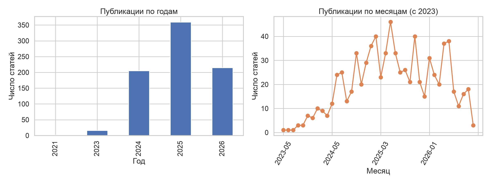
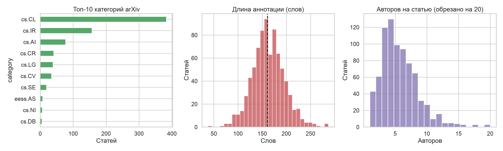
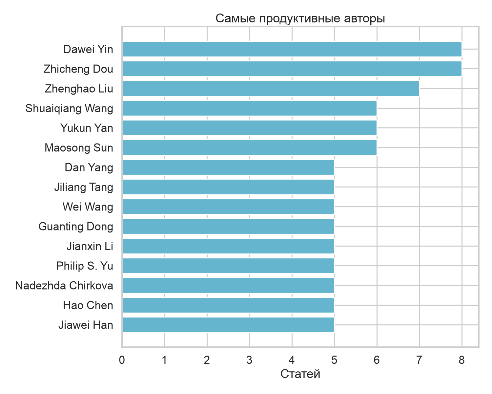

- Тема сильно междисциплинарна: помимо NLP (cs.CL) и поиска (cs.IR) заметны безопасность (cs.CR, 41 статья), зрение (cs.CV) и программная инженерия (cs.SE).
- Длины аннотаций распределены колоколообразно, большинство — 120–220 слов, то есть для извлечения терминов материала достаточно.
- Авторство сильно распылено: самый продуктивный автор имеет 8 статей из 797, сообщества авторов в корпусе не доминируют.

### Закон Ципфа

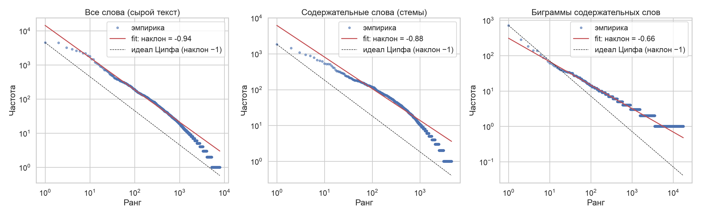

| Набор | Словарь | Токенов | Наклон log–log (1000 первых рангов) |
|---|---|---|---|
| Все слова, сырой текст | 7914 | 138 331 | **−0.94** |
| Содержательные слова (стемы, без стоп-слов) | 4590 | 68 050 | **−0.88** |
| Биграммы содержательных слов | 17 545 | 28 892 | **−0.66** |

Вывод: для полного текста закон Ципфа выполняется хорошо (наклон близок к −1 на протяжении трёх порядков ранга). После удаления стоп-слов наклон уменьшается по модулю: самые частотные слова ушли, «голова» распределения стала площе. У биграмм хвост «ступенчатый» (огромное число пар с частотой 1–2), что типично для малого корпуса — 28 тыс. токенов недостаточно, чтобы редкие биграммы заняли плавную кривую. Отклонение от идеала в области малых частот на всех графиках — следствие дискретности (много слов с частотой 1).

Закон Хипса: V ≈ 13.7·N^0.54, показатель β = 0.54 — типичный диапазон 0.4–0.6 для научных текстов; словарь не насыщается, постоянно приходят новые аббревиатуры и названия методов (`HyperGraphRAG`, `GraphRAG`, …).

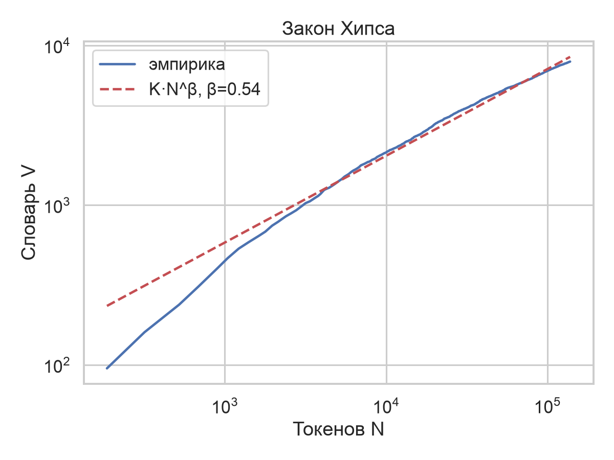
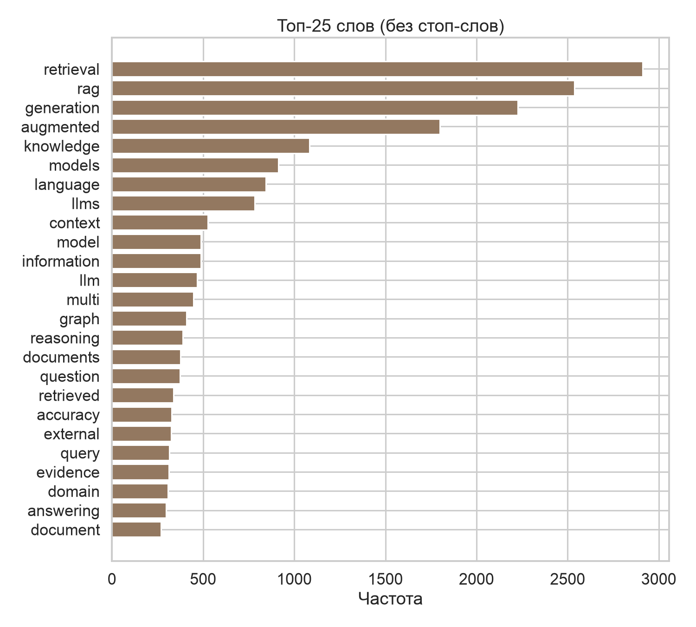

## 4. Ключевые слова

Процедура (`common.py`, `03_keywords.py`):

1. Текст = заголовок + аннотация; нижний регистр, дефисы удаляются (`multi-modal` → `multimodal`, `multi-hop` → `multihop`).
2. Из текста вырезается сама фраза «retrieval-augmented generation»/«RAG»: она есть во всех статьях и ничего не различает.
3. **Нормализация:** стеммер Snowball для сопоставления форм (`graph`/`graphs`, `retrieved`/`retrieving`), для показа выбирается самая частая исходная форма. Лемматизатор WordNet не использован: загрузка данных NLTK не прошла из-за ошибки SSL-сертификата в окружении.
4. Стоп-слова (sklearn) + список общенаучных слов («propose», «results», «novel», «significantly», …) — они разрывают фразу, поэтому n-граммы не пересекают границы.
5. Кандидаты — униграммы, биграммы, триграммы. Оценка: `tf·idf` (слова заголовка ×2), небольшая премия биграммам и триграммам. Отбрасываются термы с df < 4 и df > 35 % корпуса.
6. Вложенные термы убираются: если выбрано «knowledge graph», отдельное «graph» из той же статьи не берётся.
7. На статью — по 12 ключевых слов (`data/keywords.json`).

Итог: 2195 уникальных ключевых слов — 1502 униграммы, 640 биграмм, 53 триграммы. Самые частые: *knowledge graph* (30 статей), *agentic* (26), *natural language processing* (23), *multimodal* (23), *graph* (21), *multihop question answering* (19), *external knowledge sources* (19).

Известные недостатки: остаются слабоинформативные слова («text», «step», «page», «dynamic») и общие фразы типа «external knowledge sources»; обрезка ключевых слов по tf-idf не различает «название метода» и «общий термин». Полностью список общих слов не вычищается без ручной работы.

## 5. Граф ключевых слов

Вершина — ключевое слово (встретилось в ≥ 3 статьях, 1698 слов). Ребро — два слова входят в список ключевых слов одной статьи; вес — число таких статей.

| Вариант графа | Вершин | Рёбер | Модулярность Louvain |
|---|---|---|---|
| Полный (вес ≥ 1) | 1698 | 42 682 | 0.21 |
| **Рабочий (вес ≥ 2)**, наибольшая компонента | **874** | **1336** | **0.81** |

Почему порог 2. Каждая статья даёт клику из 12 слов с весом 1, и в полном графе 40 тысяч рёбер — «комок», где почти каждое ребро объясняется одной статьёй, а не устойчивой темой. Ребро с весом ≥ 2 означает, что пара слов повторилась в разных статьях; это отсекает случайные пары. Компонент 62, в наибольшей — 874 вершины (85 % оставшихся). Порог подобран по эксперименту (сравнивались пороги 1/2 и минимальная частота 3/4/5), поэтому высокую Q нужно читать осторожно — см. раздел 6.

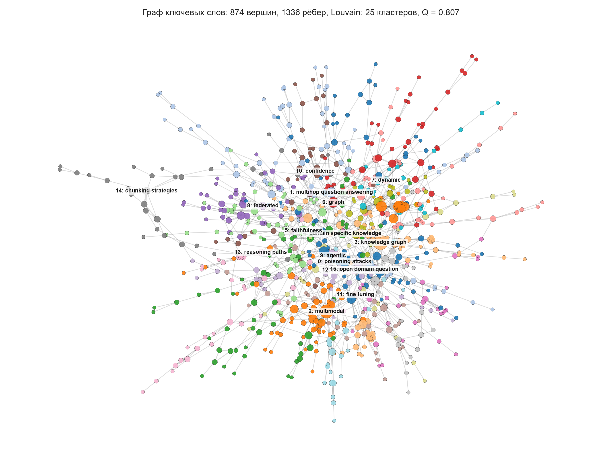
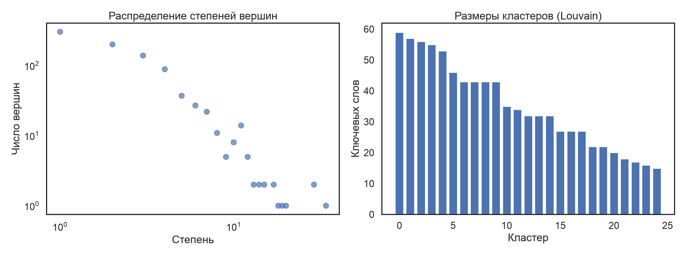

Средняя степень 3.06, плотность 0.0035, средний коэффициент кластеризации 0.17. Распределение степеней тяжелохвостое: немногие слова-хабы (*knowledge graph*, *agentic*, *multimodal*) связаны с десятками остальных.

## 6. Кластеры ключевых слов

Три алгоритма на взвешенном графе:

| Алгоритм | Кластеров | Модулярность Q | Покрытие рёбер |
|---|---|---|---|
| **Louvain** | 23 | **0.808** | 0.85 |
| Greedy modularity | 26 | 0.794 | 0.85 |
| Label propagation | 203 | 0.653 | 0.65 |

Louvain и жадная оптимизация модулярности дают близкие результаты. Label propagation дробит граф на сотни мелких групп — на разреженном графе он нестабилен, поэтому не используется.

**Контроль качества.** Для разреженных графов высокая модулярность получается и «сама по себе». Поэтому Q сравнивалась с моделью-конфигурацией (случайный граф с тем же распределением степеней, Louvain на нём): **0.64**. Реальный граф даёт 0.81, то есть превышение 0.17 — кластерная структура настоящая, но около 80 % «красоты» цифры объясняется разреженностью. Для полного графа Q = 0.21 — слабая структура, и это ожидаемо для пересекающихся тем в одной области.

### Интерпретация (по весу слов; ключевое слово = самое тяжёлое в кластере)

| № | Размер | Что в кластере | Объяснение |
|---|---|---|---|
| 0 | 57 | *multihop question answering, query decomposition, single hop, indexing, graph construction, document level* | многошаговые вопросы и построение индексов |
| 1 | 55 | *knowledge graph, attacks, adversarial, black box, explainable, counterfactual, perturbations* | атаки и объяснимость на графах знаний |
| 2 | 54 | *dynamic, memory, adaptive, cache, reducing latency, inference* | эффективность, кэш и память |
| 3 | 53 | *graph, confidence, adaptive retrieval, hallucination issues, estimates, reasoning processes* | адаптивный поиск и оценка уверенности |
| 4 | 52 | *poisoning attacks, attack success rate, defense mechanism, detection, fine tuning* | **безопасность**: отравление базы знаний |
| 5 | 52 | *agentic, recommendation, personalized, planning, students, user, interactions* | агенты, персонализация, рекомендации |
| 6 | 49 | *multimodal, vision language models, visual question answering, image, mllms, financial* | **мультимодальность** |
| 7 | 43 | *federated, privacy risks, privacy preserving, security, edge devices, defense* | **приватность** и федеративное обучение |
| 8 | 42 | *multilingual, cross lingual, metrics, english* | многоязычность |
| 9 | 41 | *domain specific knowledge, open source models, medical domain, dialogue* | прикладные домены, диалог |
| 10 | 38 | *chunking strategies, semantic chunking, fixed size, recursive, embedding models, company* | нарезка документов (chunking), корпоративные задачи |
| 11 | 35 | *faithfulness, attribution, multiagent, answer relevance, citation, trustworthy* | **достоверность и цитирование** |
| 12 | 35 | *reasoning paths, mcts, monte carlo tree search, response generation* | поиск по дереву, рассуждение |
| 14 | 31 | *parametric knowledge, hallucination detection, context length, knowledge injection* | параметрическая и внешняя память, галлюцинации |
| 18 | 27 | *ranking, reranking, bm25, retrieval noise, noisy retrieval* | переранжирование и шум |
| 20 | 25 | *entity, event, hyperedges, ary relations, incremental updates, sql* | гиперграфы и сущностно-событийные графы |
| 21 | 22 | *clinical, medical, ehrs, electronic health records, disease, diagnostic* | **медицина** |
| 22 | 16 | *automatic speech recognition, asr, low resource languages, audio, speaker, wer* | **речь** |

Полный список — `results/clusters.json`. Кластеры хорошо интерпретируются и соответствуют реальным направлениям RAG: безопасность (4), приватность (7), мультимодальность (6), агенты (5), медицина (21), речь (22), достоверность (11). Часть кластеров (2, 3, 8, 13, 17) «смешанные» — в них попали общие слова без явной темы; это результат того, что слабоинформативные слова не удалось полностью отфильтровать. Кластер 1 объединяет *knowledge graph* с *attacks*: в корпусе несколько статей про атаки на GraphRAG, и ключевые слова из них оказались связаны сильнее, чем с основным «графовым» кластером — это артефакт малой выборки, а не содержательная связь.

## 7. Центральности

Для кратчайших путей вес ребра преобразован в расстояние `1/вес` (сильная связь = короткое ребро).

| Мера | Топ-5 | Что показывает |
|---|---|---|
| **Degree** | knowledge graph (0.039), agentic (0.033), multimodal (0.033), entity (0.023), graph (0.022) | широта: с чем термин сочетается чаще всего |
| **Betweenness** | agentic (0.200), knowledge graph (0.178), multimodal (0.149), multihop question answering (0.109), graph (0.100) | «мосты» между подтемами |
| **Closeness** | agentic (0.528), knowledge graph (0.525), recommendation (0.499), multimodal (0.494), survey (0.491) | близость ко всем остальным словам |
| **Eigenvector** | entity (0.323), hyperedges (0.302), event (0.294), ary relations (0.290), incremental updates (0.287) | связь со слов-соседями, которые сами важны |
| **PageRank** | knowledge graph (0.0116), multimodal (0.0094), agentic (0.0091), graph (0.0060), faithfulness (0.0059) | «случайный блуждающий» |

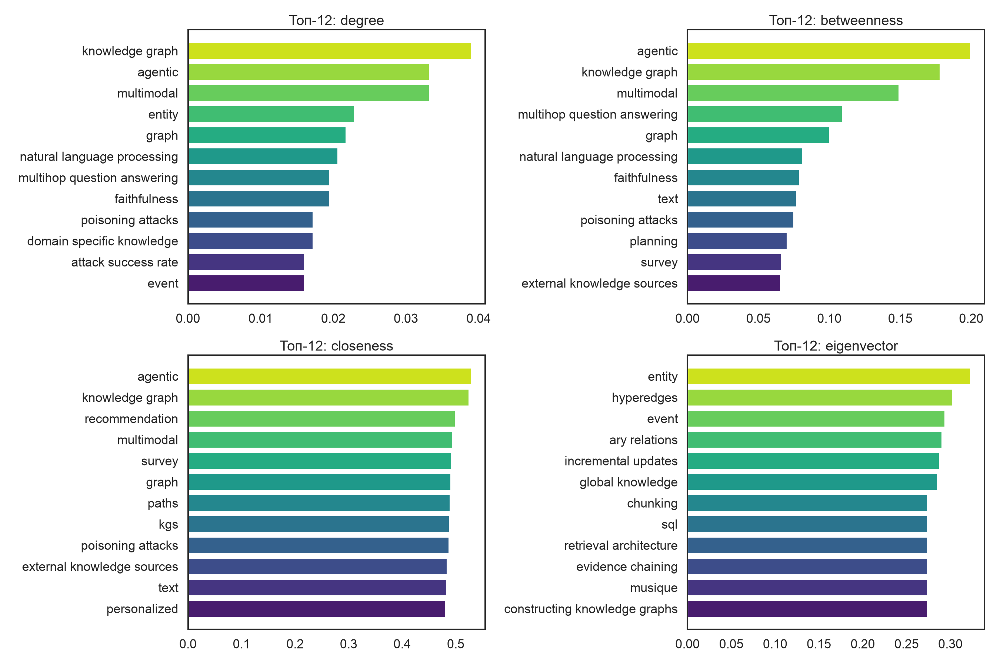
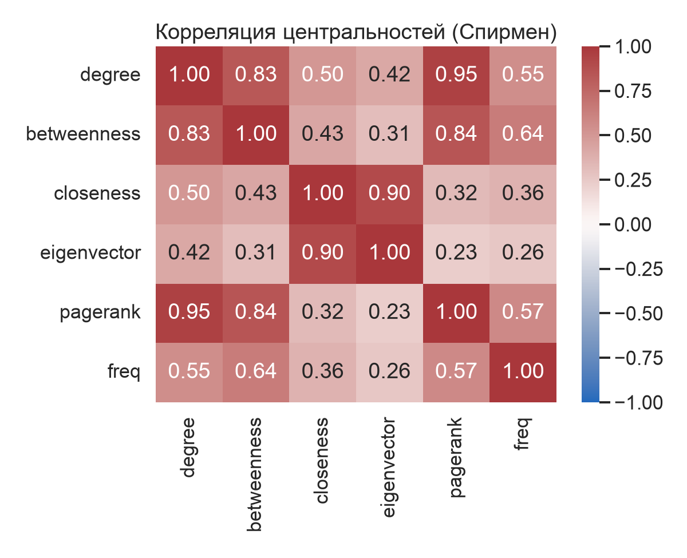

Интерпретация:

- **Три слова — *knowledge graph*, *agentic*, *multimodal* — лидируют почти по всем мерам.** Это три основные оси развития RAG: структурированные знания, автономные агенты, нетекстовые модальности. У них же максимальная betweenness: именно через них связаны остальные подтемы (например, *multimodal* соединяет зрение, медицину и финансы).
- *Agentic* — главный «мост» (betweenness 0.20): он стоит между рекомендациями, планированием, памятью и достоверностью.
- **Eigenvector выделяет совсем другое.** Лидеры — *entity, hyperedges, event, ary relations, incremental updates* — это плотная группа слов из нескольких статей про гиперграфы (кластер 20), все слова которой постоянно встречаются вместе. Они связаны между собой сильно, но с остальным графом слабо: такая мера находит «плотные ядра», а не центральные темы. Это же объясняет корреляцию 0.90 с closeness и низкую 0.23–0.42 со степенью.
- Degree, betweenness и PageRank сильно скоррелированы (Спирмен 0.83–0.95); closeness и eigenvector образуют вторую группу (0.90).

## 8. Граф публикаций

Вершина — статья (797). Ребро — есть хотя бы одно общее ключевое слово; **вес = число общих ключевых слов** (дополнительно хранится `idf_weight` — сумма idf общих слов). Слова, встречающиеся более чем в 60 статьях, не создают рёбер — иначе они склеивали бы весь корпус.

| Показатель | Значение |
|---|---|
| Вершин / рёбер | 797 / 22 264 |
| Компонент связности | 1, изолированных статей нет |
| Средняя степень | 55.9 |
| Максимальный вес ребра | 12 |

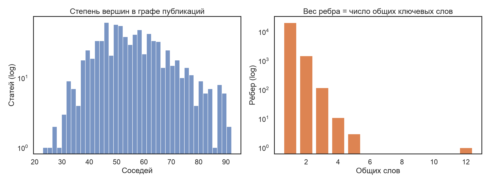

Граф плотный, но подавляющее большинство рёбер имеет вес 1; информативны именно рёбра с весом ≥ 2–3. Максимальный вес 12 — это не родство тем, а две разные версии одной статьи (одинаковый заголовок, разные arXiv id): граф их ловит как дубликаты.

## 9. Поиск

Реализован в `05_paper_graph_search.py`, две функции.

### 9.1. `similar(статья, k)` — близкие к заданной публикации

1. Соседи статьи сортируются по весу ребра (число общих ключевых слов), равные — по `idf_weight`.
2. Если соседей меньше k, выдача дополняется **персонализированным PageRank** от этой статьи (связи через общих соседей, пути длины ≥ 2).
3. Для каждого результата возвращаются общие ключевые слова — это объяснение выдачи.

Пример (`results/search_demo.txt`): для *MMRAG-RFT (Explainable Multi-modal RAG)* найдены *VideoRAG*, *Benchmarking RAG in Multi-Modal Contexts* и другие — через общие слова *multimodal knowledge / multimodal document / response generation*.

### 9.2. `search(запрос, k)` — поиск по запросу пользователя

1. Запрос нормализуется тем же конвейером, что и статьи (стемминг, стоп-слова).
2. Каждому ключевому слову графа даётся релевантность: доля его стемов, совпавших с запросом, **взвешенная по idf стемов** (общее «generation» почти не влияет, редкое «hyperedge» — сильно).
3. Оценка статьи — сумма `релевантность × idf` по её ключевым словам.
4. Оценки распространяются по графу публикаций персонализированным PageRank (`alpha = 0.3`), чтобы подтянуть статьи, не содержащие слов запроса, но тесно связанные с найденными.

Примеры:

| Запрос | Топ-3 |
|---|---|
| knowledge graph question answering | NGM-RAG; KERAG; Efficient RAG via Token Co-occurrence Graphs |
| poisoning attacks defense | One Shot Dominance: Knowledge Poisoning Attack…; BiRD: Bidirectional Ranking Defense…; Joint-GCG… |
| hallucination detection | ReDeEP; InterpDetect; Detecting Hallucinations via Semantic-level Internal Reasoning Graph |
| medical clinical decision support | MedBioLM; RAG-X (Medical QA); EEG-MedRAG |

### 9.3. Тестирование

**Поиск по запросу.** 10 запросов по темам корпуса. Статья считается релевантной, если в её полном тексте (заголовок + аннотация) есть термин темы (regex); оценка — Precision@10. Эталон строится по тексту, а не по ключевым словам, но он же благоприятен для текстового baseline (TF-IDF по полному тексту).

| Метод | Среднее P@10 |
|---|---|
| Только ключевые слова | **0.96** |
| Ключевые слова + граф (PPR) | **0.96** |
| TF-IDF по тексту (baseline) | 1.00 |

Результаты по запросам — `results/search_eval.json`, график — `figures/13_search_eval.png`. Слабее baseline поиск на запросах: *multi-hop question answering* (0.8), *long context window* и *code generation* (по 0.9); остальные — 1.0.

**Абляция PPR** (`alpha` ∈ {0.2, 0.3, 0.5, 0.7} × два способа взвесить рёбра): среднее P@10 лежит в диапазоне 0.95–0.96, то есть **PPR на этих запросах точность не повышает и не снижает**. Честный вывод: распространение по графу в этой постановке — не улучшение точности. Его назначение другое — подтянуть статьи без слов запроса (полнота), но используемая метрика P@10 по текстовому эталону этого не измеряет, а сами запросы настолько распространены, что топ-10 прямых совпадений и так заполнен.

**Поиск похожих.** Проверка двумя независимыми способами:

| Метрика | Граф (топ-5) | Случайно | Верхняя граница (TF-IDF топ-5) |
|---|---|---|---|
| Доля соседей той же категории arXiv | 0.379 | 0.286 | — |
| Средний косинус TF-IDF по полному тексту | **0.086** | 0.040 | 0.130 |

Граф находит статьи в ~2 раза ближе по тексту, чем случайный выбор, и достигает ~66 % от максимума, возможного для TF-IDF (оптимизированного именно по этой метрике). Совпадение категорий (0.38 против 0.29) — слабый сигнал, так как категории arXiv шумные (RAG-статьи одинаково попадают в cs.CL и cs.IR).

## Ограничения

- Корпус отобран запросом по фразе «retrieval-augmented generation»; статьи, использующие другую терминологию, не попали.
- Нормализация — стемминг (лемматизатор WordNet недоступен в окружении из-за SSL); возможны склейки разных слов в один стем.
- Порог рёбер ≥ 2 и размер списка ключевых слов (12) подобраны по эксперименту на этих же данных. Модулярность 0.81 нужно сравнивать с контрольной 0.64.
- Тестовых запросов 10, эталон — автоматический (regex по тексту), не разметка экспертов; baseline TF-IDF по этой схеме оценивается лучше.
- Поиск работает только по английскому словарю корпуса (запрос по-русски не даёт совпадений).
